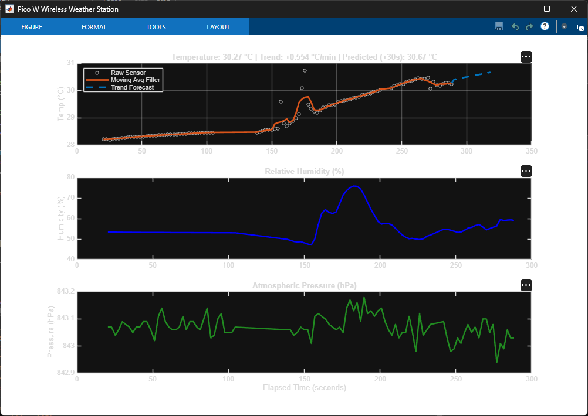

# Wireless IoT Weather Station & Micro-Climate Forecaster (Pico W + MATLAB)

A real-time wireless environmental telemetry, digital filtering, and short-term temperature forecasting system built with a **Raspberry Pi Pico W**, a **Pimoroni Enviro Indoor (BME688)** sensor board, and **MATLAB**.

## System Architecture
1. **Embedded Edge Server (MicroPython):** The Raspberry Pi Pico W reads temperature, relative humidity, barometric pressure, and VOC gas resistance from the BME688 sensor and hosts a lightweight HTTP JSON REST endpoint (`/data`) over local Wi-Fi.
2. **Data Acquisition & Signal Processing (MATLAB):** A MATLAB script polls the Pico W endpoint (`webread`), applies a moving-average digital filter (`movmean`) to attenuate sensor quantization noise, and computes an online linear regression (`polyfit`) to forecast temperature trends 30 seconds ahead.
3. **Automated Data Logging & Offline Analysis:** Automatically exports raw and filtered telemetry to `data/weather_session_log.csv` on exit for post-session statistical correlation and FFT noise analysis.

## Hardware & Bus Interface
* **Microcontroller:** Raspberry Pi Pico W (RP2040 dual-core ARM Cortex-M0+ with CYW43439 Wi-Fi)
* **Sensor Board:** Pimoroni Enviro Indoor (Bosch BME688 4-in-1 environmental sensor)
* **Communication Bus:** Hardware I2C (`SDA = GP4`, `SCL = GP5`, 7-bit I2C address `0x77`)
* **Network Protocol:** Local HTTP/1.1 REST API serving JSON payloads (`GET http://<pico-ip>/data`)

| JSON Key | Physical Measurement | Unit |
| :--- | :--- | :--- |
| `temperature_c` | Ambient Temperature | °C |
| `humidity_pct` | Relative Humidity | % |
| `pressure_hpa` | Barometric Pressure | hPa |
| `gas_ohms` | MOX Gas Sensor Resistance (VOC proxy) | Ω |

## Quick Start
1. Flash Pimoroni's custom MicroPython firmware onto your Raspberry Pi Pico W.
2. Add your Wi-Fi SSID and password in `firmware/main.py`, save it to the Pico W, and note the IP address printed in the shell.
3. Open `matlab/live_weather_forecaster.m` in MATLAB, update `pico_ip` with your Pico's IP address, and click **Run**.
4. Close the figure window at any time to stop recording and export `weather_session_log.csv`.